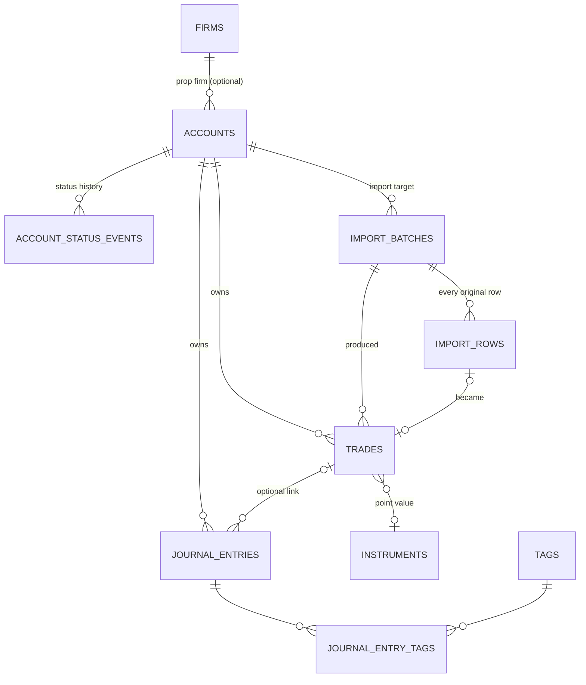

# FundedFlow local data model

Status: V1, schema version 2 (`src-tauri/migrations/0001_core_schema.sql`, `0002_seed_instruments.sql`).
Code: `src-tauri/src/db` (migrations, opening), `src-tauri/src/store` (accounts, trades, journal),
`src-tauri/src/csv_import`, `src-tauri/src/domain.rs` (validation, trading day, P&L),
`src-tauri/src/commands.rs` (Tauri commands). Frontend types and Zod schemas: `src/lib/data/`.

Everything is local. There is no network access, account system, sync or secret in the data layer.

## Entities

| Entity | Table | Key fields |
|---|---|---|
| Account | `accounts` | `id`, `name`, `broker`, prop firm (`firm_id` → `firms.name`), `external_ref`, `account_type` (`evaluation`, `sim_funded`, `live_funded`, `personal`, `demo`, `other`), `status` (`active`, `paused`, `passed`, `failed`, `closed`), `currency`, `starting_balance_micros`, `timezone`, `trading_day_reset_time`, `created_at`, `updated_at` |
| Trade | `trades` | `account_id`, `source` (`manual`/`csv_import`), `symbol`, `side` (`long`/`short`), `quantity`, `entry_at`, `entry_price`, `exit_at`, `exit_price`, `fees_micros`, `trading_day`, `reported_pnl_micros`, `gross_pnl_micros`, `net_pnl_micros`, `pnl_status`, `notes_md`, timestamps, `deleted_at` |
| Journal entry | `journal_entries` + `journal_entry_tags` → `tags` | `account_id`, optional `trade_id`, `entry_at`, `title`, `body_md`, tags, timestamps |
| CSV import | `import_batches` + `import_rows` | file name, SHA-256 and size, target `account_id`, mapping snapshot, `status` (`committed`/`failed`), `row_count`, `imported_count`, `skipped_count`, `duplicate_count`, `failed_count`, `error_summary`, `created_at`, `completed_at`; per row: original cells, status and issues |

A trade is one **round trip** (entry and optional exit). An open trade has no exit time or price. Fill-level
(execution) import and trade grouping are out of scope for V1; they can be added later with a new migration
that feeds the same `trades` table.

The schema also contains tables for later features (rulebooks/rules, account ledger, trade reviews,
strategies, checklists, attachments, risk snapshots, audit events, an inert sync outbox). They are created
and constraint-tested but have no commands yet.

## Conventions

| Concern | Decision |
|---|---|
| IDs | App-generated UUIDv7 text. Built-in seed rows use `builtin:<kind>:<code>`. |
| Instants | UTC ISO 8601 text with milliseconds and `Z` (`2026-10-19T14:30:05.123Z`), enforced by CHECK. Commands accept any ISO 8601 instant with an offset. |
| Money | INTEGER micro-units of the account currency (`*_micros`; 1 USD = 1,000,000). Commands send and return decimal strings (`"212.5"`). |
| Prices, quantities | Canonical decimal text (`"5004.25"`), parsed with `rust_decimal`. Never floating point. |
| Tables | `STRICT`, with CHECK constraints for enums, formats and cross-field rules. |
| Connections | `foreign_keys = ON`, `busy_timeout = 5 s`, WAL journal, `synchronous = NORMAL`. |

## Relationships and delete behaviour

| Action | Effect |
|---|---|
| Delete account | Hard delete. Cascades to its trades, journal entries (and their tag links), import batches and rows, status history and rulebooks. Shared tags and firms remain. "Close" an account with `status = 'closed'` instead. |
| Delete trade | Soft delete (`deleted_at`). Hidden from lists; any journal entry linking to it has `trade_id` cleared in the same transaction. The row keeps its `dedup_key`, so re-importing the CSV does not bring it back. |
| Delete journal entry | Hard delete; tag links cascade. |
| Journal ↔ trade | A journal entry may link only to a non-deleted trade **of the same account** (validated in Rust, enforced by triggers). |
| Trade ↔ account | A trade never moves between accounts; account and import provenance are immutable (trigger). |
| Account settings change | Changing currency, timezone or reset time re-derives every trade's trading day and P&L in the same transaction. |

## Database location and migrations

- File: `<app data dir>/fundedflow.db`, from Tauri's `app_data_dir()`. On Windows this is
  `%APPDATA%\com.fundedflow.desktop\fundedflow.db`. Nothing is written to the install directory or the repository.
- Migrations are SQL files embedded in the binary (`include_str!`) and listed in `db::MIGRATIONS`. The current
  version is `PRAGMA user_version`. Each pending migration runs in its own transaction with its version bump, so
  a failure leaves the database at the last good version.
- Before upgrading an existing journal, `open_file` writes a consistent copy with `VACUUM INTO` to
  `fundedflow.db.before-v<N>.bak` next to the database.
- A database from a newer app version is refused (`NewerSchema`) rather than modified.
- Rule: never edit a migration that has shipped; add `0003_….sql` and a `Migration` entry. (0001 was revised
  before V1 shipped.)

## Realized P&L

Computed in Rust (`domain::realized_pnl`) when a trade is saved, and stored:

- **Closed trade with a known instrument in the account currency**: gross = (exit − entry) × quantity × point
  value, negated for shorts. `pnl_status = 'calculated'`.
- The symbol is matched to `instruments.symbol_root` by the longest root followed by nothing, a separator, or a
  futures month code and year (`ESZ6`, `MESH26`, `MNQZ2026`, `/ESZ6`). Built-in instruments are the common CME
  group futures (migration 0002), all quoted in USD.
- **Otherwise**, if the user or CSV supplied a reported P&L, that is used (`reported`). Reported P&L is
  assumed to be in the account currency and **before fees**.
- **Otherwise** no P&L: `missing_instrument`, or `currency_mismatch` when the instrument's currency differs from
  the account's. There is no FX conversion.
- Open trades: `open`, no P&L.
- Net = gross − fees. Fees are one positive total per trade. Values are rounded half away from zero to whole
  micro-units. The schema enforces `net = gross − fees`.
- The trade's **trading day** is the exit time (or entry, while open) in the account's timezone; times at or
  after the daily reset (default 17:00 America/New_York) count toward the next day. Reset `00:00` means calendar days.

## CSV import

Flow: the UI reads the file as text and calls `preview_csv_import` (writes nothing) and then
`commit_csv_import` with the same request: account, file name, content, column mapping, source timezone.

**Mapping.** Each trade field names a CSV header (case-insensitive, surrounding spaces ignored):
`symbol`, `side`, `quantity`, `entryTime`, `entryPrice` are required; `exitTime` + `exitPrice` (together),
`fees`, `realizedPnl`, `brokerTradeId`, `notes` are optional. A missing or repeated header is a file-level
issue and nothing can be imported.

**Values.**
- Side: `long`/`short`, or `buy`/`sell`/`B`/`S`/`Bot`/`Sld` for the opening side.
- Numbers may contain `$`, thousands separators and accounting negatives `(12.50)`. Negative fees are taken as
  a positive cost.
- Times with an offset are used as-is. Times without one are read in the request's timezone, as
  `YYYY-MM-DD HH:MM[:SS[.fff]]` (or with `T`) or US `MM/DD/YYYY HH:MM[:SS]` with optional AM/PM. Ambiguous or
  non-existent local times around a daylight-saving change are rejected for that row.
- Limits: 10 MB and 50,000 rows per file.

**Results.** Every data row is classified and, on commit, stored in `import_rows` with its original cells:

| Row status | Meaning | Batch counter |
|---|---|---|
| `imported` | New trade created | `imported_count` |
| `duplicate` | Already imported into this account (links `duplicate_of_trade_id`) | `skipped_count`, `duplicate_count` |
| `skipped` | Blank row | `skipped_count` |
| `invalid` | Failed validation; `issues_json` lists each field and reason (with the CSV column name) | `failed_count` |

`row_count = imported + skipped + failed` is enforced for committed batches. `list_csv_import_problem_rows`
returns the non-imported rows with their reasons.

**Transactions.** The whole commit (batch, every row, every trade, final counts) is one transaction. If any
write fails, nothing from the file is kept, and a separate `failed` batch records the attempt with
`error_summary`. File-level problems (bad mapping, empty file, too large) are also recorded as `failed`.

### Duplicate detection

`trades.dedup_key` is unique per account. A row is a duplicate if its key already exists for the target
account (including soft-deleted trades).

- With a mapped broker trade ID: `id:<broker trade id>`. A repeated ID within one file is a duplicate of the
  first.
- Without one: `h:` + SHA-256 of symbol, side, quantity, entry time (UTC), entry price, exit time and exit
  price, plus the row's **occurrence number** among identical rows in the same file. Two identical round trips in
  one export are both kept; re-importing that export, or a longer export containing it, matches them again.
- The preview also flags a file whose SHA-256 was already committed to the account.

Limitations:
- Fees, P&L and notes are not part of the key, so a re-export that only corrects fees is treated as a duplicate
  (edit the trade instead).
- Two exports that format the same trade differently (e.g. second vs. millisecond times, rounded prices) produce
  different keys and import twice.
- Manual trades have no key, so a manual trade and the same trade imported later are not matched.
- Duplicates are scoped per account; importing the same file into two accounts creates trades in both.

## Commands

| Area | Commands |
|---|---|
| Accounts | `list_accounts`, `create_account(input)`, `update_account(id, input)`, `delete_account(id)` |
| Trades | `list_trades(accountId)`, `create_trade(input)`, `update_trade(id, input)`, `delete_trade(id)` |
| Journal | `list_journal_entries(accountId)`, `create_journal_entry(input)`, `update_journal_entry(id, input)`, `delete_journal_entry(id)` |
| CSV | `preview_csv_import(request)`, `commit_csv_import(request)`, `list_csv_imports(accountId)`, `list_csv_import_problem_rows(batchId)` |

Updates replace all editable fields. Inputs are validated in TypeScript (Zod) and again in Rust before any write.
Errors are `{ kind: "validation" | "notFound" | "conflict" | "database", message, issues? }`, with `issues` naming
each invalid field.
