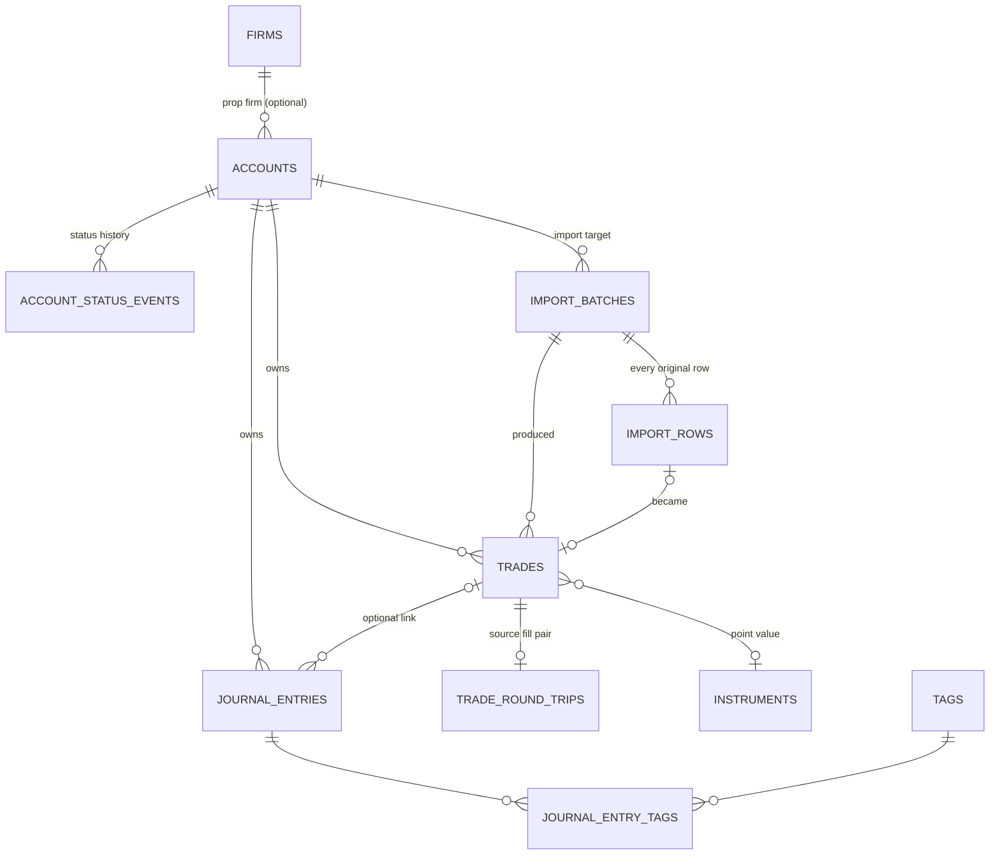

# FundedFlow local data model

Status: V1, schema version 4 (`apps/desktop/src-tauri/migrations/0001_core_schema.sql`, `0002_seed_instruments.sql`, `0003_round_trip_imports.sql`, `0004_archive_accounts.sql`).
Code: `apps/desktop/src-tauri/src/db` (migrations, opening), `apps/desktop/src-tauri/src/store` (accounts, trades, journal),
`apps/desktop/src-tauri/src/csv_import`, `apps/desktop/src-tauri/src/domain.rs` (validation, trading day, P&L),
`apps/desktop/src-tauri/src/commands.rs` (Tauri commands). Frontend types and Zod schemas: `apps/desktop/src/lib/data/`.

Everything is local. There is no network access, account system, sync or secret in the data layer.

## V1 source-of-truth policy

- **Round-trip first.** The unit of record is a canonical `trades` row (one round trip: entry and optional exit).
  Imported trades keep their immutable original CSV row (`import_rows`) and, for paired-fill exports, the
  immutable source fill pair (`trade_round_trips`). There is no executions ledger; trades cannot be recomputed
  from raw executions.
- **Rust is authoritative for calculations.** Validation, trading day, instrument lookup and realized P&L are
  computed in `src-tauri/src/domain.rs` and stored. The Zod schemas in `packages/domain/src/contracts` mirror the
  input rules for early feedback but never compute stored values. A calculation moves to TypeScript (e.g. a
  shared `packages/domain`) only together with parity tests that run the same cases against both
  implementations and prove identical results; see [`architecture/packages.md`](architecture/packages.md).
- **SQLite is authoritative for persistence.** Every write goes through a Tauri command and one SQLite transaction.

Not supported by the round-trip pipeline (V1 limitations): partial fills and partial exits, scale-in/scale-out
as one position, regrouping fills into trades, execution-based risk analysis (MAE/MFE, intraday drawdown from
fills), and FX conversion.

## Entities

| Entity | Table | Key fields |
|---|---|---|
| Account | `accounts` | `id`, `name`, `broker`, prop firm (`firm_id` → `firms.name`), `external_ref`, `account_type` (`evaluation`, `sim_funded`, `live_funded`, `personal`, `demo`, `other`), `status` (`active`, `paused`, `passed`, `failed`, `closed`), `currency`, `starting_balance_micros`, `timezone`, `trading_day_reset_time`, `created_at`, `updated_at` |
| Trade | `trades` | `account_id`, `source` (`manual`/`csv_import`), `symbol`, `side` (`long`/`short`), `quantity`, `entry_at`, `entry_price`, `exit_at`, `exit_price`, `fees_micros`, `trading_day`, `reported_pnl_micros`, `gross_pnl_micros`, `net_pnl_micros`, `pnl_status`, `notes_md`, timestamps, `deleted_at` |
| Journal entry | `journal_entries` + `journal_entry_tags` → `tags` | `account_id`, optional `trade_id`, `entry_at`, `title`, `body_md`, tags, timestamps |
| CSV import | `import_batches` + `import_rows` | file name, SHA-256 and size, target `account_id`, `source_format` (`performance`/`generic`), mapping snapshot, `status` (`committed`/`failed`), `row_count`, `imported_count`, `skipped_count`, `duplicate_count`, `failed_count`, `warning_count`, `error_summary`, `created_at`, `completed_at`; per row: original cells, status, errors and warnings |
| Round-trip source | `trade_round_trips` | For trades from a performance export: buy/sell fill IDs, prices, parsed and original timestamps, duration, contract metadata and which fill opened the trade. Immutable. |

A trade is one **round trip** (entry and optional exit). An open trade has no exit time or price. Fill-level
(execution) import and trade grouping are out of scope for V1; they can be added later with a new migration
that feeds the same `trades` table.

`accounts` also has schema-only columns that no command reads or writes yet: `programme_id`,
`parent_account_id` (evaluation → funded successor link), `account_size_micros` and `opened_on`.

### Implementation status

| Status | Tables |
|---|---|
| **Implemented** (commands, store code and tests) | `accounts`, `firms` (find-or-create by name), `account_status_events` (written on create and status change), `instruments` (seeded by 0002, read-only), `trades`, `trade_round_trips`, `import_batches`, `import_rows`, `journal_entries`, `tags`, `journal_entry_tags` |
| **Reserved** (created and constraint-tested in 0001, no commands) | `app_meta` (journal_id etc. not yet written), `settings`, `programmes`, `account_ledger_entries`, `rulebook_versions`, `rules`, `csv_mapping_profiles`, `strategies`, `checklists`, `checklist_items`, `checklist_results`, `trade_reviews`, `trade_review_tags`, `attachments`, `attachment_links`, `account_snapshots`, `audit_events`, `sync_outbox` (inert) |
| **Not in the schema** (future execution-first extension) | `executions`, `execution_fees`, `trade_executions`, `account_phase_events`, provider catalogue families/variants/phases, reusable rulebooks and `account_rulebook_assignments` |

Reserved tables are a starting point, not a finished design. In particular `rulebook_versions` is
account-owned (`account_id NOT NULL`, cascades on account delete), whereas Build 9.5 plans reusable, versioned
rulebooks assigned to accounts. `firms`/`programmes` predate the Build 9 provider catalogue. Those builds add
forward-only migrations (0004+) that map these tables; they must not edit 0001–0003.

## Conventions

| Concern | Decision |
|---|---|
| IDs | App-generated UUIDv7 text. Built-in seed rows use `builtin:<kind>:<code>`. |
| Instants | UTC ISO 8601 text with milliseconds and `Z` (`2026-10-19T14:30:05.123Z`), enforced by CHECK. Commands accept any ISO 8601 instant with an offset. |
| Money | INTEGER micro-units of the account currency (`*_micros`; 1 USD = 1,000,000). Commands send and return decimal strings (`"212.5"`). |
| Prices, quantities | Canonical decimal text (`"5004.25"`), parsed with `rust_decimal`. Never floating point. |
| Tables | `STRICT`, with CHECK constraints for enums, formats and cross-field rules. |
| Connections | `foreign_keys = ON`, `busy_timeout = 5 s`, WAL journal, `synchronous = NORMAL`. |

## Relationships and delete behaviour

| Action | Effect |
|---|---|
| Archive account | Soft delete (`archived_at`, migration 0004). Hidden from lists and read-only: reading or writing its trades, journal entries and imports returns not-found. Nothing is removed, and an archived account's broker account number can be reused. The app never hard-deletes accounts; the schema's `ON DELETE CASCADE` remains for a future permanent-delete flow (Build 24). "Close" an account with `status = 'closed'` to keep it visible. |
| Delete trade | Soft delete (`deleted_at`). Hidden from lists; any journal entry linking to it has `trade_id` cleared in the same transaction. The row keeps its `dedup_key`, so re-importing the CSV does not bring it back. |
| Delete journal entry | Hard delete; tag links cascade. |
| Journal ↔ trade | A journal entry may link only to a non-deleted trade **of the same account** (validated in Rust, enforced by triggers). |
| Trade ↔ account | A trade never moves between accounts; account and import provenance are immutable (trigger). |
| Account settings change | Changing currency, timezone or reset time re-derives every trade's trading day and P&L in the same transaction. |

## Database location and migrations

- File: `<app data dir>/fundedflow.db`, from Tauri's `app_data_dir()`. On Windows this is
  `%APPDATA%\com.fundedflow.desktop\fundedflow.db`. Nothing is written to the install directory or the repository.
- Migrations are SQL files embedded in the binary (`include_str!`) and listed in `db::MIGRATIONS`. The current
  version is `PRAGMA user_version`. Each pending migration runs in its own transaction with its version bump, so
  a failure leaves the database at the last good version.
- Before upgrading an existing journal, `open_file` writes a consistent copy with `VACUUM INTO` to
  `fundedflow.db.before-v<N>.bak` next to the database.
- A database from a newer app version is refused (`NewerSchema`) rather than modified.
- Rule: never edit a migration that has shipped; add the next `000N_….sql` and a `Migration` entry. (0001 was revised
  before V1 shipped.)

## Startup and recovery

A database problem never stops the window from opening (`apps/desktop/src-tauri/src/runtime.rs`). Startup records the outcome,
and the frontend's `RuntimeGate` shows a recovery screen until the runtime is ready. While it isn't, every data
command returns `{ kind: "unavailable" }`; the UI never reads that as "no accounts".

- `runtime_status()` (read-only) returns `{ state: "initializing" | "ready" | "failed", schemaVersion,
  supportedSchemaVersion, created, failure }`. `created` is true only when this start created a new, empty journal.
- `retry_runtime()` re-runs the real open → backup → migrate path. It is a no-op when ready; concurrent retries
  run one at a time and all see the same result. Each attempt is bounded by SQLite's 5 s busy timeout.
- Recovery never deletes, resets, downgrades or replaces the journal. A file that fails to open stays byte-for-byte unchanged.

| `failure.category` | Meaning | Retryable |
|---|---|---|
| `data_directory` | The per-user data folder could not be resolved or created | yes |
| `open_failed` | The file exists but can't be opened or read (locked, corrupt, not a database) | yes |
| `backup_failed` | The pre-upgrade backup could not be written; no upgrade was attempted | yes |
| `migration_failed` | A migration failed and rolled back; the journal stays at its previous version | yes |
| `newer_schema` | Written by a newer FundedFlow; left untouched | no |

`failure.message` is safe to show the user, and `failure.detail` is the technical error.

## Realized P&L

Computed in Rust (`domain::realized_pnl`) when a trade is saved, and stored:

- **Closed trade with a known instrument in the account currency**: gross = (exit − entry) × quantity × point
  value, negated for shorts. `pnl_status = 'calculated'`.
- The symbol is matched to `instruments.symbol_root` by the longest root followed by nothing, a separator, or a
  futures month code and year (`ESZ6`, `MESH26`, `MNQZ2026`, `/ESZ6`). Built-in instruments are the common CME
  group futures (migration 0002), all quoted in USD.
- **Otherwise**, if the user or CSV supplied a reported P&L, that is used (`reported`). Reported P&L is
  assumed to be in the account currency and **before fees**.
- **Otherwise** no P&L: `missing_instrument`, or `currency_mismatch` when the instrument's currency differs from
  the account's. There is no FX conversion.
- Open trades: `open`, no P&L.
- Net = gross − fees. Fees are one positive total per trade. Values are rounded half away from zero to whole
  micro-units. The schema enforces `net = gross − fees`.
- The trade's **trading day** is derived from the exit time (or entry, while open); see below.

## Trading day

`domain::trading_day`, computed when a trade is saved and stored in `trades.trading_day` (`YYYY-MM-DD`):

1. Convert the instant to the account's `timezone` (IANA; DST handled by the tz database).
2. If the account's `trading_day_reset_time` is not `00:00` and the local time is **at or after** the reset,
   the trade belongs to the **next** calendar date. Otherwise it belongs to the local date.
3. If that date is a **Saturday or Sunday, it rolls forward to Monday**.

**Allowed reset times: `00:00` (calendar days) or `12:00`–`23:59`.** An afternoon or evening reset opens the
next day's session (the CME convention: the 17:00 New York reset opens the next day's Globex session), which is
what step 2 assumes. Morning resets (`00:01`–`11:59`) are rejected by `domain::is_allowed_reset_time` (account
create/update) and by the Zod schema, because with a 06:00 reset a Monday 07:00 trade would land on Tuesday.

| Account reset | Fill (local time) | Trading day |
|---|---|---|
| 17:00 New York | Mon 16:59 | Mon |
| 17:00 New York | Mon 17:00 | Tue |
| 17:00 New York | Fri 17:30 | Mon (Sat → Mon) |
| 17:00 New York | Sun 18:00 | Mon |
| 00:00 | Sat 10:00 | Mon |

Builds 9, 15.5 and 16 (phases, daily-loss and ledger checkpoints, rules engine) must group by this stored value
rather than re-deriving days.

Existing data: the database CHECK only enforces `HH:MM`, so an account saved with a morning reset before this
rule keeps it (and the old "next day" result) until it is edited, when validation asks for an allowed time.
Stored trading days of existing trades are re-derived only when the account's currency, timezone or reset
changes, so weekend-dated trades saved before the Monday rollover keep their old day until then.

## CSV import

Code: `apps/desktop/src-tauri/src/csv_import/` — `parse` (CSV reading, limits), `detect` (format and header mapping),
`values` (strict value parsers), `normalize` (row → trade, errors and warnings), `dedup` (identity keys),
`mod.rs` (preview, atomic commit, history). UI: `apps/desktop/src/components/CsvImportSection.tsx`.

Flow: the UI reads the chosen file as text on this computer and calls `preview_csv_import` (writes nothing).
The preview shows the detected format and mapping, every row's original line number, parsed values, warnings,
errors and duplicate status. Only after the user confirms does `commit_csv_import` save, re-running the same
analysis. Nothing is sent over the network: the file goes from the webview to the Rust process over Tauri IPC.

### Parsing

RFC 4180 CSV via the `csv` crate: quoted fields with embedded commas, newlines and doubled quotes; CRLF or LF;
a leading UTF-8 BOM is ignored. Line numbers are computed from byte offsets (header = line 1). Empty files,
a missing header row, header-only files, records with the wrong number of fields and unreadable records are
reported with clear messages. Limits: **10 MB and 50,000 data rows per file**; the preview lists every row up to
2,000 and, beyond that, every row with a finding.

### Formats and mapping

Headers are matched ignoring case, spaces and punctuation (`Buy Price` = `buy_price` = `buyPrice`; `P&L` = `pl`).

**Performance export (paired fills)** — detected when `symbol`, `qty`, `buyPrice`, `sellPrice`, `boughtTimestamp`
and `soldTimestamp` are present (e.g. Tradovate's Performance report). Each row is one completed round trip:

| Field | Column | Notes |
|---|---|---|
| Symbol | `symbol` | Required. |
| Quantity | `qty` | Required, > 0. |
| Buy / sell price | `buyPrice`, `sellPrice` | Required, plain decimals. |
| Buy / sell time | `boughtTimestamp`, `soldTimestamp` | Required; stored as parsed UTC **and** as the original text. |
| Fill IDs | `buyFillId`, `sellFillId` | Optional; the pair is the duplicate key. |
| Realized P&L | `pnl` | Optional; `$26.00`, `$0.00`, `$(36.00)`, `-$36.00`. |
| Duration | `duration` | Optional; `32sec`, `1min 17sec`, `1hr 2min`, `1:02:03`. |
| Contract metadata | `_priceFormat`, `_priceFormatType`, `_tickSize` | Optional; stored as supplied. |

*Entry side (assumption, shown in the preview):* the fill that happened first opened the trade. Buy first ⇒
**long** (entry = buy, exit = sell). Sell first ⇒ **short** (entry = sell, exit = buy) — this is the
"`soldTimestamp` earlier than `boughtTimestamp`" case. Such rows are imported but carry a warning, and both
source timestamps, prices and fill IDs are kept unchanged in `trade_round_trips` for review. Equal timestamps
are taken as long. The export has no fee column, so fees are 0.

**Generic trade CSV** — one trade per row. Required: symbol, side (`long`/`short`/`buy`/`sell`/`B`/`S`), quantity,
entry time, entry price. Optional: exit time + exit price (together), fees, P&L, broker trade ID, notes. Common
broker header names are matched automatically (e.g. `Ticker`, `Action`, `Open Time`, `Close Price`, `Commission`,
`P&L`, `Trade ID`); the user can map any field to any column. The source row is kept in `import_rows.raw_json`.

### Validation

Errors exclude the row; warnings do not.

- Symbol: letters, digits and ` ._/:-+=^#&`, up to 32 characters.
- Quantity > 0; prices are finite plain decimals (`29774.25`, `1,234.5`); no `NaN`, `inf` or exponents.
- Money (`pnl`, fees): optional `$`, sign or accounting parentheses, well-formed thousands separators.
  Negative fees are taken as a positive cost, with a warning.
- Durations: units in descending order (`d`, `hr`/`h`, `min`/`m`, `sec`/`s`), or `H:MM:SS` / `M:SS`.
- **Dates are parsed in exactly one format per file**: `YYYY-MM-DD HH:MM[:SS[.fff]]` (or RFC 3339 with offset),
  `M/D/YYYY HH:MM[:SS]` or `D/M/YYYY HH:MM[:SS]`, optional AM/PM, four-digit years only. "Auto" picks the format
  every timestamp fits; if both M/D and D/M fit (all days ≤ 12) the import stops until the user chooses.
  Performance exports default to M/D/YYYY in that case. Values without an offset are read in the chosen
  time zone; times that are ambiguous or skipped at a daylight-saving change are row errors.
- Warnings: sell fill before buy fill; `duration` differing from the time between fills by more than 1 s;
  exported P&L differing from the calculated P&L; only one fill ID present; non-numeric tick size.

### Results

| Row status | Meaning | Batch counter |
|---|---|---|
| `imported` (`new` in preview) | Saved as a trade | `imported_count` |
| `duplicate` | Same identity as an earlier line or a saved trade; reason shown, `duplicate_of_trade_id` linked | `duplicate_count` (also in `skipped_count`) |
| `skipped` (`blank` in preview) | Blank row | `skipped_count` |
| `invalid` | Errors listed per field with the CSV column name | `failed_count` |

`warning_count` counts rows with warnings, of any status. Every row is stored in `import_rows` with original
cells, errors and warnings; `list_csv_import_problem_rows` returns the rows not imported or with warnings.

**Atomicity.** The batch record, every row record, every trade and every round-trip source record are written
in one transaction. If anything fails, nothing from the file is kept and a separate `failed` batch records the
attempt. File-level problems (bad mapping, ambiguous dates, empty or oversized file) are also recorded as `failed`.

### Duplicate detection

Each valid row gets an identity key; `trades.dedup_key` is unique per account. A row is a duplicate if an
earlier line of the same file, or any trade of the account (including soft-deleted ones), has the same key. The
preview explains which line or saved trade it matches.

| Row | Key |
|---|---|
| Performance row with both fill IDs | `fills:<buyFillId>:<sellFillId>` — the **pair**. Rows sharing only a buy fill (one buy closed by several sells) or only a sell fill are distinct. |
| Generic row with a broker trade ID | `id:<trade id>` |
| Otherwise | `rt:` + SHA-256 of the normalized fields: format, symbol, quantity, both prices, both timestamps (UTC), reported P&L (and side for generic rows). |

Limitations:
- Without IDs, two genuinely identical round trips in one file are indistinguishable; the second is flagged as
  a duplicate (the preview says so) and not imported.
- Fees and notes are not part of the key, so a re-export that only corrects fees is a duplicate (edit the trade).
- The same trade exported in two different formats or with different timestamp precision produces different
  keys. Manual trades have no key. Duplicates are scoped per account.
- Deleted imported trades keep their key, so re-importing the file does not bring them back.

## Commands

| Area | Commands |
|---|---|
| Runtime | `runtime_status()`, `retry_runtime()` (see [Startup and recovery](#startup-and-recovery)) |
| Accounts | `list_accounts`, `create_account(input)`, `update_account(id, input)`, `archive_account(id)` |
| Trades | `list_trades(accountId)`, `create_trade(input)`, `update_trade(id, input)`, `delete_trade(id)` |
| Journal | `list_journal_entries(accountId)`, `create_journal_entry(input)`, `update_journal_entry(id, input)`, `delete_journal_entry(id)` |
| CSV | `preview_csv_import(request)`, `commit_csv_import(request)`, `list_csv_imports(accountId)`, `list_csv_import_problem_rows(batchId)` |

Updates replace all editable fields. Inputs are validated in TypeScript (Zod) and again in Rust before any write.
Errors are `{ kind: "validation" | "notFound" | "conflict" | "database" | "unavailable", message, issues? }`, with `issues` naming
each invalid field.
