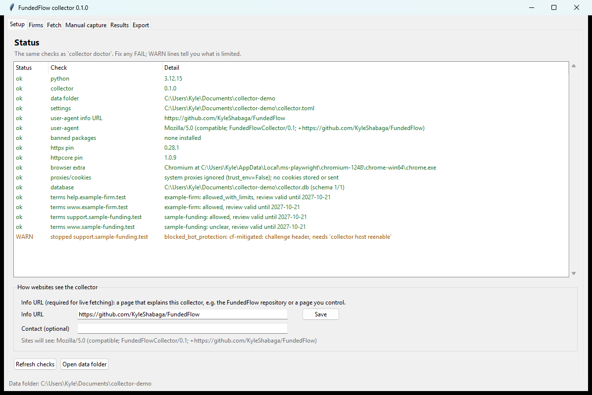
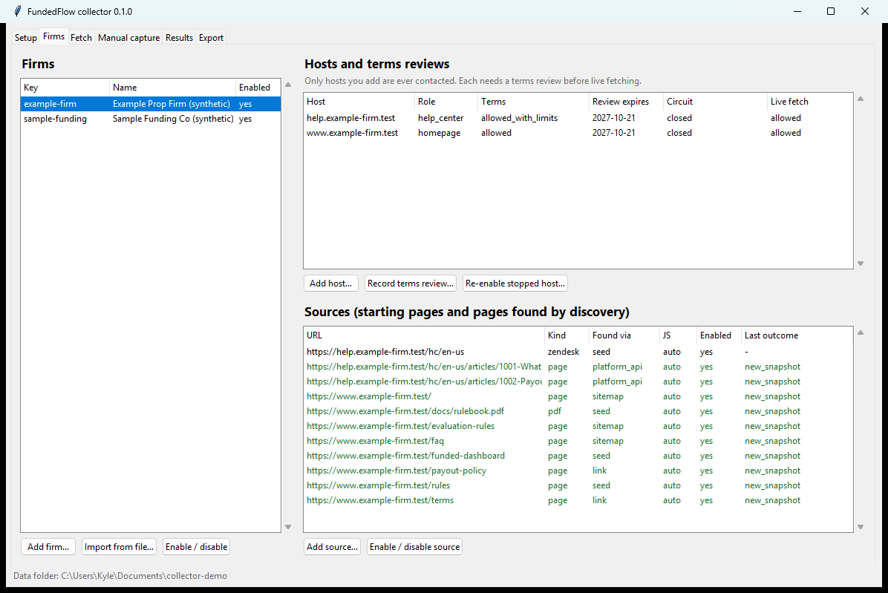
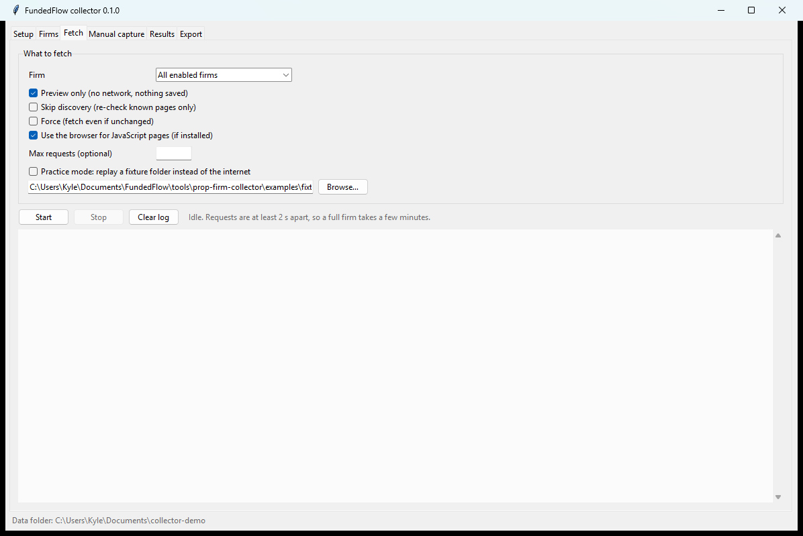
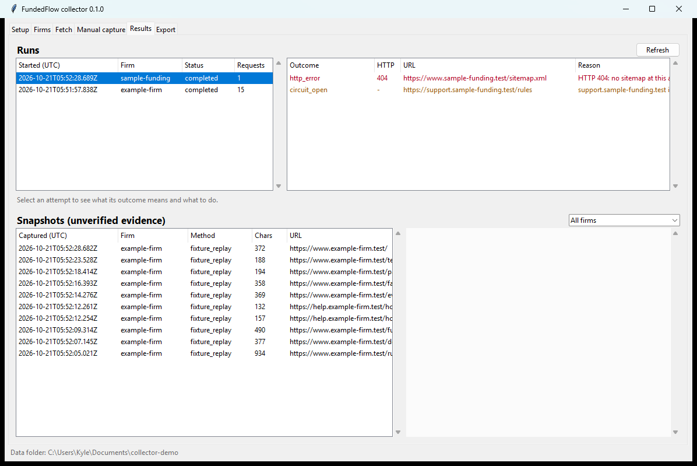

# FundedFlow collector: user guide (Windows)

This guide is for people who are comfortable with PowerShell but don't need to know Python. Every command below
(apart from opening Notepad) was run on Windows 11 with PowerShell 7 against the synthetic practice firms that ship
with the tool. The output is real but trimmed, and folder paths are shortened to `C:\Users\<you>\...`.

> **Prefer clicking to typing?** After installing (section 2), run `uv run collector-gui` or create a desktop
> shortcut. The desktop window does everything in this guide with buttons and forms: see
> [section 14](#14-the-desktop-window).

## 1. What this tool does and doesn't do

**It does:**

- keep a list of prop firms, their official websites and help centers, and your decision about each site's terms
  of use;
- read public rule pages (web pages, PDFs and Zendesk help-center articles) slowly and politely, and only from the
  sites you approved;
- save each version of each page as a dated, unchangeable snapshot on your computer, and tell you when a page
  changed;
- import pages you saved yourself from your browser;
- export everything as a JSON file that a later FundedFlow feature (Build 31) can read.

**It doesn't:**

- interpret rules. "This page changed" never means "the rule changed". A person still has to read it;
- mark anything as verified. Everything it produces is **unverified evidence**;
- log in, bypass blocks, solve CAPTCHAs, hide what it is, or use proxies;
- update the FundedFlow app or its database. It has its own separate database;
- run by itself. Nothing happens until you type a command.

## 2. Install

You need Windows 10 or 11, PowerShell, Git and about 1 GB of disk space (most of it for the optional browser).

### Where to type the commands

Open PowerShell: press **Start**, type `PowerShell`, and open it (Windows Terminal works too). The window shows a
**prompt** that tells you which folder you're in. A new window starts in your home folder:

```text
PS C:\Users\Kyle>
```

`PS` means PowerShell and `C:\Users\Kyle` is the current folder (yours shows your own user name). Type each command
after the `>` and press Enter. Don't type the `PS ...>` part. Each command has to run from the right folder:

| Commands | Run them from | The prompt looks like |
|---|---|---|
| `winget install ...` | Anywhere | `PS C:\Users\Kyle>` |
| `git clone ...` | The folder you want the code in, e.g. Documents | `PS C:\Users\Kyle\Documents>` |
| Every `uv ...` command (`uv sync`, `uv run collector ...`) | The collector folder inside the code | `PS C:\Users\Kyle\Documents\FundedFlow\tools\prop-firm-collector>` |

To get to the collector folder in a new PowerShell window (for example after a restart), use `cd` ("change
directory"):

```powershell
cd $HOME\Documents\FundedFlow\tools\prop-firm-collector
```

```text
PS C:\Users\Kyle\Documents\FundedFlow\tools\prop-firm-collector>
```

If you cloned the code somewhere else, `cd` into that copy's `tools\prop-firm-collector` folder instead. If a
`uv run collector` command answers `error: Failed to spawn: collector` / `cause: program not found`, you're in the
wrong folder. Check the prompt and `cd` to the collector folder.

### Steps

1. Install `uv`, the tool that installs Python and the collector's dependencies. Run this from any folder:

   ```powershell
   winget install --id astral-sh.uv -e
   ```

   Close and reopen PowerShell afterwards so the `uv` command is found.

2. Get the code and install. This puts the code in your Documents folder and then moves into the collector folder,
   where every later command runs. `uv` downloads Python 3.12 by itself, and the dependency versions are locked with
   checksums:

   ```powershell
   cd $HOME\Documents
   git clone https://github.com/KyleShabaga/FundedFlow.git
   cd FundedFlow\tools\prop-firm-collector
   uv sync
   ```

3. Optional, but recommended: the browser add-on, used only for pages whose text appears through JavaScript:

   ```powershell
   uv sync --extra browser
   uv run playwright install chromium
   ```

4. Check the installation:

   ```powershell
   uv run collector doctor
   ```

   ```text
   [ok  ] python                 3.12.15
   [ok  ] collector              0.1.0
   [ok  ] data folder            C:\Users\<you>\AppData\Local\FundedFlow\Collector
   [ok  ] settings               C:\Users\<you>\AppData\Local\FundedFlow\Collector\collector.toml (not found; defaults)
   [WARN] user-agent info URL    not set: live fetching is refused until user_agent.info_url is set
   [ok  ] banned packages        none installed
   [ok  ] httpx pin              0.28.1
   [ok  ] httpcore pin           1.0.9
   [ok  ] browser extra          Chromium at C:\Users\<you>\AppData\Local\ms-playwright\chromium-1248\chrome-win64\chrome.exe
   [ok  ] proxies/cookies        system proxies ignored (trust_env=False); no cookies stored or sent
   [WARN] database               not created yet: run `collector init-db`
   ```

   A healthy result has no `FAIL` lines. The two `WARN` lines go away after the next section. If you skipped
   step 3, the browser line says `info ... not available`, which is fine.

From here on, every command runs from the collector folder
(`PS C:\Users\Kyle\Documents\FundedFlow\tools\prop-firm-collector>`).

## 3. First-time setup

Create the collector's own database and an example settings file:

```powershell
uv run collector init-db
```

```text
Wrote example settings to C:\Users\<you>\AppData\Local\FundedFlow\Collector\collector.toml
Created database: C:\Users\<you>\AppData\Local\FundedFlow\Collector\collector.db (schema version 1)
Logs:    C:\Users\<you>\AppData\Local\FundedFlow\Collector\logs
Exports: C:\Users\<you>\AppData\Local\FundedFlow\Collector\exports
```

Everything the collector stores lives in that one folder. It is separate from the FundedFlow app's own data
(`%APPDATA%\com.fundedflow.desktop`), which the collector refuses to open.

**Set the info URL.** Websites see a short, honest description of the collector with every request, including a
link that explains what it is. Live fetching is refused until this is set. Open the settings file:

```powershell
notepad $env:LOCALAPPDATA\FundedFlow\Collector\collector.toml
```

Remove the `#` in front of the `info_url` line and point it at the FundedFlow repository or at a page you control.
Or do it in one command:

```powershell
$cfg = "$env:LOCALAPPDATA\FundedFlow\Collector\collector.toml"; (Get-Content $cfg) -replace "^# info_url", "info_url" | Set-Content $cfg; Select-String -Path $cfg -Pattern "^info_url"
```

```text
C:\Users\<you>\AppData\Local\FundedFlow\Collector\collector.toml:5:info_url = "https://github.com/KyleShabaga/FundedFlow"
```

Sites then see: `Mozilla/5.0 (compatible; FundedFlowCollector/0.1; +https://github.com/KyleShabaga/FundedFlow)`.
You can also add `contact = "you@example.com"` under `[user_agent]`.

## 4. Add a firm

A firm needs three things before anything is fetched: the firm itself, its **hosts** (the firm's own website
addresses, each approved by you), and your **terms review** for each host. Then you add a few starting pages
(**sources**).

```powershell
uv run collector firm add sample-funding --name 'Sample Funding Co (synthetic)' --homepage https://www.sample-funding.test/
uv run collector host add --firm sample-funding --host www.sample-funding.test --role homepage
uv run collector host add --firm sample-funding --host support.sample-funding.test --role help_center
```

```text
Added firm sample-funding (Sample Funding Co (synthetic)).
Authorised www.sample-funding.test for sample-funding as homepage.
Next: read the site's terms, then `collector host terms --firm sample-funding --host www.sample-funding.test ...`
```

Subdomains are never assumed: `help.firm.com` and `www.firm.com` each need their own `host add`. Use the role
`asset` only for a help-center vendor's script server that the browser add-on needs. Asset hosts are never read as
pages.

### Recording your terms review

Open the firm's terms of use in your browser and decide what they say about automated access. Then record one of
four decisions:

| Decision | Use it when | Effect |
|---|---|---|
| `allowed` | The terms permit it, or say nothing restrictive and you're comfortable | Live fetching at normal pace (2 s between requests) |
| `allowed_with_limits` | Allowed with conditions, e.g. a slower rate | Live fetching; add `--min-delay SECONDS` for the condition |
| `unclear` | You can't tell | Blocked unless you add `--accept-unclear-terms`, then fetching at a slower 5 s pace |
| `prohibited` | "No robots, spiders or scrapers without written permission" or similar | Manual capture only (section 7) |

A short checklist for reading terms:

1. Search the page (Ctrl+F) for *robot*, *spider*, *scrap*, *crawl*, *automated*, *data mining*.
2. Look for rate limits or "written permission" requirements.
3. Check that the terms cover the help center too (it is sometimes a different company's site).
4. Write down what you found with `--notes`. If in doubt, choose `unclear` or `prohibited`.

Many firms will be `prohibited`. That is a normal outcome: use manual capture, or ask the firm with the template
in [`permission-request.md`](permission-request.md).

```powershell
uv run collector host terms --firm sample-funding --host www.sample-funding.test --decision unclear --terms-url https://www.sample-funding.test/terms --notes 'No clause about automated access found'
```

```text
Recorded terms for www.sample-funding.test: unclear.
Live fetching: not allowed (terms for www.sample-funding.test are unclear and were not acknowledged with --accept-unclear-terms).
```

```powershell
uv run collector host terms --firm sample-funding --host www.sample-funding.test --decision unclear --terms-url https://www.sample-funding.test/terms --notes 'No clause about automated access found' --accept-unclear-terms
uv run collector host terms --firm sample-funding --host support.sample-funding.test --decision allowed --terms-url https://www.sample-funding.test/terms
```

```text
Recorded terms for www.sample-funding.test: unclear.
Live fetching: allowed.
Recorded terms for support.sample-funding.test: allowed.
Live fetching: allowed.
```

Your acknowledgement is saved with the time you gave it. A review stays valid for 365 days. After that the host is
blocked until you review it again.

### Starting pages

```powershell
uv run collector source add --firm sample-funding --url https://www.sample-funding.test/program-rules --label 'Program rules' --priority 10
uv run collector source add --firm sample-funding --url https://support.sample-funding.test/rules
```

```text
Added source src_314d82243c11d10038888c8ccfb733b8: https://www.sample-funding.test/program-rules (page).
Added source src_7cb877e0e82f0c53698938f86aa2d2d7: https://support.sample-funding.test/rules (page).
```

Use `--kind pdf` for a PDF, `--kind sitemap` for a sitemap address, and `--kind zendesk` with a help-center address
like `https://help.firm.com/hc/en-us` to read its articles through Zendesk's public API.

### Adding a firm from a file

The same setup can live in a file. [`config/firms/example-firm.toml`](../config/firms/example-firm.toml) is a
complete synthetic example (running the import again just updates it):

```powershell
uv run collector firm import --file config\firms\example-firm.toml
uv run collector firm list
uv run collector host list
```

```text
Added firm example-firm.
  host www.example-firm.test (homepage)
  host help.example-firm.test (help_center)
  source https://www.example-firm.test/rules (page)
  source https://www.example-firm.test/docs/rulebook.pdf (pdf)
  source https://www.example-firm.test/funded-dashboard (page)
  source https://help.example-firm.test/hc/en-us (zendesk)

FIRM            NAME                           ENABLED  HOSTS  SOURCES  MAX FETCHES
--------------  -----------------------------  -------  -----  -------  -----------
example-firm    Example Prop Firm (synthetic)  yes      2      4        40
sample-funding  Sample Funding Co (synthetic)  yes      2      2        default

HOST                         ROLE         TERMS                   REVIEW EXPIRES  CIRCUIT  LIVE FETCH
---------------------------  -----------  ----------------------  --------------  -------  ----------
help.example-firm.test       help_center  allowed_with_limits     2027-10-21      closed   ok
www.example-firm.test        homepage     allowed                 2027-10-21      closed   ok
support.sample-funding.test  help_center  allowed                 2027-10-21      closed   ok
www.sample-funding.test      homepage     unclear (acknowledged)  2027-10-21      closed   ok
```

## 5. Preview before fetching

`--dry-run` shows what would be requested and what would be blocked, without any network access and without saving
anything:

```powershell
uv run collector fetch --all --dry-run
```

```text
Dry run for example-firm (no network, nothing saved):
DECISION  URL                                              WHY
--------  -----------------------------------------------  -------------------------------------------
allowed   https://help.example-firm.test/hc/en-us          robots.txt not cached: would fetch it first
allowed   https://www.example-firm.test/docs/rulebook.pdf  robots.txt not cached: would fetch it first
...
```

After a first fetch, robots.txt is cached for 24 hours and the preview shows real decisions:

```powershell
uv run collector fetch --firm example-firm --dry-run
```

```text
DECISION        URL                                              WHY
--------------  -----------------------------------------------  -----------------------------------------------------
allowed         https://help.example-firm.test/hc/en-us          would wait 3 s per request
allowed         https://www.example-firm.test/rules              would wait 2 s per request
robots_blocked  https://www.example-firm.test/private/internal   robots.txt disallows this URL for FundedFlowCollector
```

`allowed` means the request would be made. Anything else is the reason it would not be (see the table in section 8).

## 6. Fetch

The examples use `--fixture-site examples\fixture-site`, which replays the synthetic practice sites from your disk
instead of the internet. Snapshots made this way are labelled `fixture_replay`. For a real firm, leave that option
out.

```powershell
uv run collector fetch --firm example-firm --fixture-site examples\fixture-site
```

```text
Fixture replay from examples\fixture-site (no network; recorded as fixture_replay).
Discovering example-firm
  help.example-firm.test: robots.txt read (HTTP 200)
  www.example-firm.test: robots.txt read (HTTP 200)
Fetching example-firm (budget 40 requests)
  new_snapshot             https://www.example-firm.test/rules
  new_snapshot             https://www.example-firm.test/docs/rulebook.pdf
  new_snapshot             https://www.example-firm.test/funded-dashboard
  new_snapshot             https://help.example-firm.test/hc/en-us/articles/1001-What-is-the-daily-loss-limit (Zendesk API)
  new_snapshot             https://help.example-firm.test/hc/en-us/articles/1002-Payout-eligibility (Zendesk API)
  new_snapshot             https://www.example-firm.test/evaluation-rules
  new_snapshot             https://www.example-firm.test/faq
  ...
  robots_blocked           https://www.example-firm.test/private/internal
example-firm: completed; 15 requests; new_snapshot 10, robots_blocked 1
  Details: collector runs show run_91cedc12f9d84e71be30e67d828cdca3
  robots_blocked: Use manual capture.
```

What happened:

1. **Discovering**: the collector read each host's robots.txt, then the sitemaps it lists (and `/sitemap.xml`),
   and asked the Zendesk help center for its article list.
2. **Fetching**: your starting pages first, then the most relevant discovered pages (rules, evaluation, drawdown,
   payout, FAQ…), within the budget. `funded-dashboard` shows its text only through JavaScript, so the browser
   add-on rendered it automatically.
3. Each line is one page and its outcome. The summary line counts them, and the lines under it say what to do
   about anything that wasn't fetched.

Then all firms, one after another (never at the same time):

```powershell
uv run collector fetch --all --fixture-site examples\fixture-site
```

```text
Fetching example-firm (budget 40 requests)
  skipped_lastmod          https://www.example-firm.test/rules
  unchanged                https://www.example-firm.test/docs/rulebook.pdf (304)
  unchanged                https://www.example-firm.test/funded-dashboard (304)
  ...
Discovering sample-funding
  support.sample-funding.test: STOPPED (blocked_bot_protection: cf-mitigated: challenge header)
  support.sample-funding.test: robots.txt unreachable (no response); treated as disallow-all
  www.sample-funding.test: robots.txt read (HTTP 200)
Fetching sample-funding (budget 75 requests)
  new_snapshot             https://www.sample-funding.test/program-rules
  circuit_open             https://support.sample-funding.test/rules
example-firm: completed; 10 requests; robots_blocked 1, skipped_lastmod 2, unchanged 7
sample-funding: completed; 5 requests; circuit_open 1, new_snapshot 2
  circuit_open: See `host list`. Rate limits clear after 24 h; other blocks need `host reenable`.
```

The second run asked "has this changed?" and the pages answered no (`304`), or the sitemap said they hadn't changed
(`skipped_lastmod`), so nothing was downloaded again. The practice host `support.sample-funding.test` behaves like a
site behind bot protection, so the collector stopped that host immediately (see section 9).

When a page really changes, the next fetch stores a new snapshot next to the old one:

```text
  new_snapshot             https://www.example-firm.test/faq
example-firm: completed; 10 requests; new_snapshot 1, robots_blocked 1, skipped_lastmod 2, unchanged 6
```

**How long it takes.** Requests to one site are at least 2 seconds apart (5 seconds for `unclear` terms, slower if
the site asks or responds slowly), so a firm with the default budget of 75 requests takes about 3 to 4 minutes. The
practice firm above took 33 seconds for 15 requests.

**Useful options:** `--no-discover` (skip discovery and re-check known pages), `--force` (fetch even if the
sitemap or a 304 says unchanged), `--no-browser`, `--max-fetches 20` (a smaller budget), `--headed` (watch the
browser window).

The exit code is `0` when everything was fetched or unchanged, `4` when some pages were blocked by a rule (as
above), and `5` when some failed. See the README for the full list.

## 7. Manual capture

Manual capture works for every firm, including ones whose terms prohibit automated access or whose site blocks the
collector, and it makes no network requests. It's the recommended way to start with real firms.

1. Open the page in your browser.
2. Save it with **Ctrl+S → "Webpage, HTML only"** (or "Webpage, Complete"), or **Ctrl+P → "Save as PDF"**, or
   copy the text into a `.txt` file.
3. Import it with the page's original address:

```powershell
uv run collector import-capture --firm sample-funding --url https://www.sample-funding.test/payouts --file examples\captures\sample-funding-payouts.html --captured-at 2026-10-20T14:30:00Z
uv run collector import-capture --firm sample-funding --url https://www.sample-funding.test/terms-of-use --file examples\captures\sample-funding-terms.pdf
uv run collector import-capture --firm sample-funding --url https://www.sample-funding.test/faq --file examples\captures\sample-funding-faq.txt
```

```text
new_snapshot: snap_07ccb8b3202089003345c43147a7ead1
  title     Payout rules | Sample Funding Co
  text      273 characters
  captured  2026-10-20T14:30:00.000Z (manual_capture)
  warnings  thin_content
new_snapshot: snap_a0d84916eb3a0553463a00dfe665a8d2
  title     Sample Funding Terms
  text      187 characters
  captured  2026-10-21T04:53:50.617Z (manual_capture)
```

`--captured-at` is when you saved the page, in UTC (the `Z`). Leave it out to use the current time. The page's
host must already be registered for the firm (any terms decision is fine). Importing the same file again records
`unchanged` rather than making a duplicate.

## 8. Reading results

```powershell
uv run collector runs
uv run collector runs show run_b7abfc62c9df48268bbdf95b4c387fe1
```

```text
RUN                                   FIRM            COMMAND  STARTED                   STATUS     REQUESTS  ATTEMPTS
------------------------------------  --------------  -------  ------------------------  ---------  --------  --------
run_b7abfc62c9df48268bbdf95b4c387fe1  example-firm    fetch    2026-10-21T04:53:33.321Z  completed  10        11
run_348bd108ce484d699e71ceb555c59ae1  sample-funding  fetch    2026-10-21T04:53:03.817Z  completed  5         4

Run run_b7abfc62c9df48268bbdf95b4c387fe1 (example-firm, fetch): completed
  outcomes: http_error 1, new_snapshot 1, robots_blocked 1, skipped_lastmod 2, unchanged 6

OUTCOME          HTTP  METHOD          URL                                              REASON
---------------  ----  --------------  -----------------------------------------------  -----------------------------------------------------
http_error       404   fixture_replay  https://help.example-firm.test/sitemap.xml       HTTP 404
skipped_lastmod  -     fixture_replay  https://www.example-firm.test/rules              sitemap lastmod 2026-10-01
unchanged        304   fixture_replay  https://www.example-firm.test/docs/rulebook.pdf  -
new_snapshot     200   fixture_replay  https://www.example-firm.test/faq                -
robots_blocked   -     fixture_replay  https://www.example-firm.test/private/internal   robots.txt disallows this URL for FundedFlowCollector
```

(The `404` for `/sitemap.xml` is the collector checking whether a sitemap exists. It's recorded but doesn't count
as a failure.)

```powershell
uv run collector snapshots --url https://www.example-firm.test/faq
uv run collector snapshots show snap_bc4ece5680f23e33033eb93740b5dc20 --text
```

```text
SNAPSHOT                               FIRM          CAPTURED                  METHOD          CHARS  URL
-------------------------------------  ------------  ------------------------  --------------  -----  ---------------------------------
snap_bc4ece5680f23e33033eb93740b5dc20  example-firm  2026-10-21T04:53:44.123Z  fixture_replay  356    https://www.example-firm.test/faq
snap_fd5fa7d3d136128311ea81c0ccc33b9e  example-firm  2026-10-21T04:52:35.332Z  fixture_replay  358    https://www.example-firm.test/faq

Snapshot snap_bc4ece5680f23e33033eb93740b5dc20 (unverified evidence)
  requested  https://www.example-firm.test/faq
  captured   2026-10-21T04:53:44.123Z
  method     fixture_replay
  hash       sha256:baa57e77fba0b27dc72b00416750d09a70f7e99a6e3827644c73acaf2370f5dc
  parser     trafilatura+bs4 (trafilatura 2.3.1; bs4 4.15.0; lxml 6.1.3)
  seen       1 time(s), first 2026-10-21T04:53:44.123Z, last 2026-10-21T04:53:44.123Z
  structure  3 headings, 0 tables, 8 links
  ...
Payouts can be requested after the simulated funded account has at least ten trading days.
```

Snapshots are never changed or deleted, and failed fetches never remove them. Page text is shown as plain text and
never run, so instructions written inside a page have no effect.

### Outcome codes

| Outcome | Kind | What happened | What to do |
|---|---|---|---|
| `new_snapshot` | ok | Page fetched; its content is new or changed, so a new snapshot was stored. | Nothing. A changed page is not a confirmed rule change. |
| `matched_earlier_snapshot` | ok | Content changed back to text already stored in an earlier snapshot. | Nothing. |
| `unchanged` | ok | Server said 304 Not Modified, or the content matches the latest snapshot. | Nothing. |
| `skipped_lastmod` | ok | Sitemap lastmod is not newer than the last snapshot, so the page was not requested. | Nothing. Use --force to fetch anyway. |
| `not_allowlisted` | policy | The URL (or a redirect) points at a host you have not authorised for this firm. | Add the host with `host add` only if it is the firm's own site. |
| `excluded_path` | policy | The path matches one of the firm's excluded patterns. | Nothing, or edit the patterns. |
| `url_rejected` | policy | Unsafe or invalid URL (scheme, credentials, port, IP literal or length). | Fix the URL. |
| `address_blocked` | policy | The host resolved to a private, loopback, link-local or reserved address. | Nothing. The collector only connects to public internet addresses. |
| `disabled` | policy | The firm or source is disabled. | Enable it if that was a mistake. |
| `terms_blocked` | policy | No current terms review allows automated access to this host (missing, older than 365 days, prohibited, or unclear without --accept-unclear-terms). | Review the terms with `host terms`, or use manual capture. |
| `robots_blocked` | policy | robots.txt disallows this URL for FundedFlowCollector. | Use manual capture. |
| `robots_unreachable` | policy | robots.txt could not be read (429, 5xx, timeout), which RFC 9309 treats as disallow-all. | Try again another day, or use manual capture. |
| `circuit_open` | policy | This host is stopped after an earlier block or rate limit. | See `host list`. Rate limits clear after 24 h; other blocks need `host reenable`. |
| `budget_exhausted` | policy | The per-firm fetch budget for this run is used up. | Run again later. |
| `deadline_exceeded` | policy | The run reached its time limit. | Run again later. |
| `access_denied` | failure | The site answered 401, 451 or a persistent 403. The host is stopped. | Do not work around it. Use manual capture or ask the firm, then `host reenable` if they agree. |
| `blocked_bot_protection` | failure | The site showed a bot challenge. The host is stopped until you re-enable it. | Do not work around it. Use manual capture or ask the firm. |
| `rate_limited` | failure | The site answered 429 Too Many Requests. | Wait. A third 429 in one run stops the host for 24 hours. |
| `http_error` | failure | The site answered another 4xx status, such as 404 Not Found. | Check the URL; older snapshots are kept. |
| `server_error` | failure | The site answered 5xx after retries. | Try again later. |
| `timeout` | failure | The request timed out. | Try again later. |
| `network_error` | failure | DNS or connection failure. | Check your internet connection. |
| `too_large` | failure | The response exceeded the size limit. | Use manual capture if you need it. |
| `unsupported_content_type` | failure | The response is not HTML, PDF, XML, JSON or plain text. | Nothing. |
| `parse_error` | failure | The document could not be parsed. | Try manual capture as PDF or text. |
| `parse_timeout` | failure | PDF extraction exceeded its time or memory limit and was stopped. | Use manual capture as text. |
| `render_unavailable` | failure | The page needs JavaScript but the [browser] extra is not installed or is turned off. | Install the extra, or use manual capture. |
| `render_error` | failure | The browser could not render the page. | Try again, or use manual capture. |

Snapshots can also carry **warnings**: `thin_content` (very little text), `fallback_full_text` (the whole page text
was kept because the main-content extractor found little), `pdf_truncated` (page or text limit reached),
`browser_requests_blocked` (the browser skipped images or off-site scripts, as designed) and
`normalization_changed` (same download, different text after a tool upgrade, so not a page change).

## 9. When a firm blocks you

The collector stops talking to a site as soon as the site says no: a bot-protection challenge, `401`, `451`, a
`403` that's still there after one retry, or a third "too many requests" (`429`) in one run. In the example above,
`support.sample-funding.test` showed a challenge page:

```powershell
uv run collector host list --firm sample-funding
uv run collector doctor
```

```text
HOST                         ROLE         TERMS                   REVIEW EXPIRES  CIRCUIT                 LIVE FETCH
---------------------------  -----------  ----------------------  --------------  ----------------------  ----------
support.sample-funding.test  help_center  allowed                 2027-10-21      blocked_bot_protection  ok
www.sample-funding.test      homepage     unclear (acknowledged)  2027-10-21      closed                  ok

[WARN] stopped support.sample-funding.test blocked_bot_protection: cf-mitigated: challenge header, needs `collector host reenable`
```

What it did: stopped that host for this run and every later run, recorded why, and carried on with the firm's other
hosts. It did not retry through another address, another page, the browser, or any other route.

- **Rate limits** (`rate_limited`) clear by themselves after 24 hours.
- **Blocks** (`blocked_bot_protection`, `access_denied`) stay until you re-enable the host yourself.

The right response to a block is **manual capture** (section 7) or **asking the firm**
([`permission-request.md`](permission-request.md)), not working around it. Only re-enable a host when the firm
has agreed or you know the cause is fixed:

```powershell
uv run collector host reenable --host support.sample-funding.test --reason 'Firm confirmed by email that read-only access is fine'
```

```text
Re-enabled support.sample-funding.test (was blocked_bot_protection).
```

Why this matters: a site's bot protection can also start blocking *your own browser* on that site from the same
internet connection. Stopping at the first sign protects your normal access to your firm.

## 10. Export

```powershell
uv run collector export --all
```

```text
Wrote C:\Users\<you>\AppData\Local\FundedFlow\Collector\exports\collector-evidence-2026-10-21-e3e79c8f.json
  export_id  exp_e3e79c8f19236d622a4407e1dd694f4d
  firms 2, snapshots 16, attempts 0
  schema     collector-snapshot-v1: valid
  status     unverified evidence (not rules, not verified provider data)
```

To choose the file name and also get a spreadsheet-friendly list (URLs and dates only, no page text):

```powershell
uv run collector export --all --out $env:TEMP\fundedflow-evidence.json --csv $env:TEMP\fundedflow-evidence.csv
uv run collector validate $env:TEMP\fundedflow-evidence.json
```

```text
Wrote C:\Users\<you>\AppData\Local\Temp\fundedflow-evidence.json
  ...
  csv        C:\Users\<you>\AppData\Local\Temp\fundedflow-evidence.csv
C:\Users\<you>\AppData\Local\Temp\fundedflow-evidence.json: valid collector-snapshot-v1 (16 snapshots, unverified)
```

Every export is checked against the published format before it's written. If the check fails, nothing is written
and the exit code is `6`. Use `--firm KEY` (repeatable) instead of `--all` for some firms only, and
`--include-attempts` to add the full request log. Exporting the same data twice gives the same `export_id`.

The file is **unverified evidence for Build 31**: page text with its source and date. It is not a rulebook and
must not be imported into FundedFlow as rules. A person reviews any rule values that are later extracted from it.

## 11. Network and VPN guidance

- **Default: no VPN needed.** At these volumes (a few dozen polite requests per firm, seconds apart), your normal
  home connection is the expected setup.
- **A VPN can make blocks more likely, not less.** Commercial VPN addresses are shared by many people and often
  flagged, so bot-protection services challenge them more than home connections.
- **Watch your trading accounts.** Some prop firms monitor the addresses you log in from and may flag VPN use or
  sudden address changes on trading accounts. If you use a VPN for the collector, don't let it change the address
  you trade or log in from, and check your firm's rules first. A system-wide VPN affects every app on the PC, so a
  per-app (split-tunnel) setup is safer if you must use one.
- **If you already use a VPN for everyday privacy,** that's fine. Keep one fixed server for collector runs and
  don't switch servers mid-run.
- **Never use a VPN to get around a block.** Switching servers, or turning a VPN on after a firm blocked or
  rate-limited the collector, is IP rotation, which this project prohibits. Use manual capture or contact the firm
  instead.
- The collector ignores Windows proxy settings, but it can't see or control a VPN. This guidance is for you.

## 12. Troubleshooting and reset

| Message | Meaning and fix |
|---|---|
| `no collector database at ...; run collector init-db first` | Run `uv run collector init-db`. |
| `set user_agent.info_url in collector.toml before fetching` | See section 3. |
| `unknown firm 'missing-firm'; see collector firm list` | Check the key with `uv run collector firm list`. |
| `host ... is not an authorised document host for ...` | Add the host first (`host add`), and only if it's the firm's own site. |
| `another collector command is running` | Only one fetch or import runs at a time. Wait, or close the other window. |
| `refusing to use ...: it is inside the FundedFlow app data folder` | The collector never uses the app's folder. Pick another `--data-dir`. |
| `... is in use; close other collector windows` (during reset) | Close other PowerShell windows running the collector, then retry. |
| `uv` is not recognised | Close and reopen PowerShell after installing uv. |
| `error: Failed to spawn: collector` / `cause: program not found` | You're in the wrong folder. Run `cd $HOME\Documents\FundedFlow\tools\prop-firm-collector` (section 2). |

```powershell
uv run collector fetch --firm missing-firm
uv run collector source add --firm sample-funding --url https://elsewhere.test/rules
```

```text
Error: unknown firm 'missing-firm'; see `collector firm list`
Error: host elsewhere.test is not an authorised document host for sample-funding
```

Logs (one JSON line per event, with tokens in addresses removed) are in
`%LOCALAPPDATA%\FundedFlow\Collector\logs`.

**Reset (delete the collector's test data).** This deletes only the collector's own database, logs and exports. Your
settings file is kept (add `--include-config` to remove it too), and the FundedFlow app is never touched:

```powershell
uv run collector reset
uv run collector reset --yes
```

```text
  would delete C:\Users\<you>\AppData\Local\FundedFlow\Collector\collector.db
  would delete C:\Users\<you>\AppData\Local\FundedFlow\Collector\exports
  would delete C:\Users\<you>\AppData\Local\FundedFlow\Collector\logs
Error: add --yes to delete these collector files

  deleted C:\Users\<you>\AppData\Local\FundedFlow\Collector\collector.db
  deleted C:\Users\<you>\AppData\Local\FundedFlow\Collector\exports
  deleted C:\Users\<you>\AppData\Local\FundedFlow\Collector\logs
Collector data reset. The FundedFlow app database was not touched.
```

## 13. Suggested routine

- **Weekly at most, per firm:** `uv run collector fetch --firm KEY --no-discover` to re-check the pages you already
  know. It is quick when little has changed, because unchanged pages answer `304` or are skipped.
- **Monthly:** a full `uv run collector fetch --firm KEY` with discovery, to find new pages.
- **When a firm announces a rule change:** fetch that firm once, then read the new snapshot yourself with
  `snapshots show ... --text`.
- **Yearly, per host:** re-read the terms of use and record them again with `host terms` (reviews expire after 365
  days).
- **Whenever a site blocks you:** switch that firm to manual capture and leave the host stopped.
- Run `uv run collector doctor` now and then to see expiring reviews and stopped hosts.

## 14. The desktop window

Everything in this guide can also be done in a window, with no commands to type. The window uses exactly the same
safety rules as the commands (approved hosts only, terms reviews, robots.txt, pacing, stopping when a site says no),
and it adds no setting that could weaken them.

**Open it** from the collector folder (section 2):

```powershell
uv run collector-gui
```

Or make a desktop shortcut once, then double-click **FundedFlow Collector** on your desktop:

```powershell
.\scripts\create-shortcut.ps1
```

```text
Created C:\Users\Kyle\Desktop\FundedFlow Collector.lnk
```

The first time it opens, it creates the data folder, database and settings file by itself (what `init-db` does).

| Tab | What you do there | Same as |
|---|---|---|
| **Setup** | See the health checks; enter and **Save** the info URL and optional contact | `doctor`, editing `collector.toml` |
| **Firms** | **Add firm…** or **Import from file…**; select a firm, then **Add host…**, **Record terms review…**, **Re-enable stopped host…**, **Add source…**, enable/disable sources | `firm`, `host`, `source` |
| **Fetch** | Choose a firm (or all), tick **Preview only** to check first, untick it to fetch; **Start**, and **Stop** if you need to | `fetch`, `fetch --dry-run` |
| **Manual capture** | Pick the firm, paste the page's original address, **Browse…** to the saved file, **Import** | `import-capture` |
| **Results** | Click a run to see every request; click a request to see what its outcome means and what to do; click a snapshot to read its text | `runs`, `snapshots` |
| **Export** | All firms or one, optional request log and CSV, **Export**; **Validate a file…** | `export`, `validate` |





A live fetch asks you to confirm before contacting any website. **Practice mode** on the Fetch tab replays the
synthetic practice sites instead of the internet (the same as `--fixture-site`), which is a safe way to learn the
window. Progress lines appear as each page is checked. **Stop** finishes the current request, saves what it has,
and marks the run `aborted`.





Only one fetch or import runs at a time, whether it was started from the window or from PowerShell. If a command
says "another collector command is running", wait for the window's run to finish.
